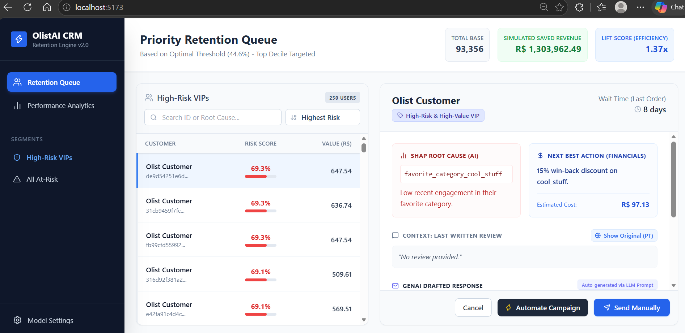
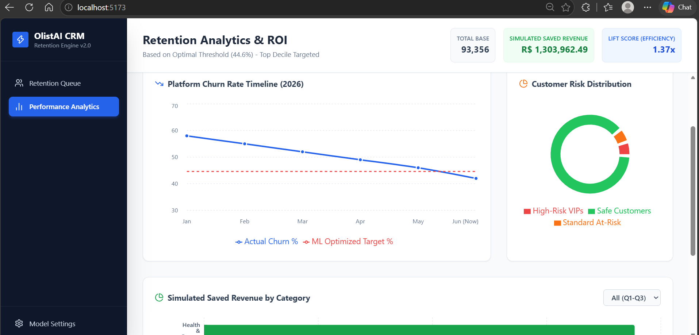

# ⚡ OlistAI CRM: Enterprise Customer Retention & Decision-Support Framework

### 📸 Dashboard Previews

## 📌 Project Overview
This project upgrades a traditional Machine Learning churn prediction model into a **Full-Stack Enterprise Decision-Support System**. 

Instead of just predicting *who* will churn, this framework utilizes **XGBoost, SHAP, and Generative AI** to determine *why* they are leaving, calculate the exact financial cost to keep them, and automatically draft hyper-personalized win-back campaigns. 

The backend is powered by a **Python FastAPI**, dynamically serving the ML outputs to a modern **React (Vite) + Tailwind CSS** frontend dashboard, enabling non-technical stakeholders to make data-driven marketing decisions.

## 🛠️ Tech Stack
* **Machine Learning:** Python, XGBoost, SHAP (Explainable AI), Pandas
* **Backend API:** FastAPI, Uvicorn
* **Frontend Interface:** React.js, Tailwind CSS, Lucide Icons, Recharts
* **Generative AI:** Integrated LLM Prompt Engineering for automated email drafting

## 🚀 Key Features
1. **Cost-Sensitive Threshold Optimization:** Shifts the prediction threshold from a standard 50% to a mathematically optimized 44.6%, maximizing True Positives (saved VIPs) while strictly limiting False Positives (wasted marketing spend).
2. **Financial ROI Simulator:** Calculates estimated saved revenue (R$ 1.3M+) and marketing efficiency (Lift Score) dynamically based on the model's threshold settings.
3. **SHAP Root Cause Analysis:** Translates complex ML feature importance into human-readable diagnostic text for individual customers.
4. **GenAI Action Engine:** Automatically drafts personalized, context-aware emails using the customer's specific root cause (e.g., extreme shipping delays) and dynamic Next Best Actions (NBA).
5. **Interactive React Dashboard:** A production-ready UI featuring real-time data filtering, segment queues, and dynamic data visualization (Recharts).

## 💻 How to Run Locally
1. Clone the repository.
2. Start the Python Backend: `uvicorn main:app --reload` (Runs on port 8000)
3. Start the React Frontend: `npm run dev` (Runs on port 5173)